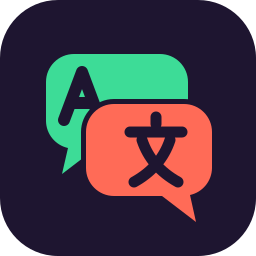

<div align="center">
  

  <h1>BOLBOT</h1>

  <p><strong>Your squad speaks five languages. Your Discord doesn't have to choose one.</strong></p>

  <p>
    <a href="https://github.com/ManveerAnand/BOLBOT/actions/workflows/ci.yml"></a>
    <a href="LICENSE"></a>
    
    
  </p>
</div>

BOLBOT translates your Discord server live. Everyone types in their own language and reads everyone else in theirs, under each person's real name. No copy-pasting into a translator, no "English only" rule, nobody left out of the callouts.

It's free, it runs on your own PC or Mac, and your chats never leave it.

## What it feels like

Set it up with three commands, then everyone just chats:

<p align="center">
  
</p>

<details>
<summary>On the Discord phone app</summary>
<p align="center">
  
</p>
</details>

Replies, edits, deletes, screenshots and stickers all follow along.

## Why BOLBOT

- **Free, for good.** No subscription and no API bill. The translator runs on your own computer.
- **Private.** Messages are translated on your machine and never saved. Nothing goes to a cloud translator.
- **Feels native.** Translations show up as the person who wrote them, not as a bot.
- **12 languages.** English, Chinese, Indonesian, Japanese, Korean, Spanish, French, German, Hindi, Portuguese, Russian and Turkish.
- **Set and forget.** It starts with your computer and restarts itself if anything goes wrong.

## Get started

You need a Discord server where you're an admin, about 10 minutes, and one of these:

- **Windows 10 or 11.** A graphics card makes translations near-instant; without one they take a few seconds.
- **A Mac with Apple Silicon** (M1 or newer).

### On Windows

**1. Open PowerShell** (press Start, type PowerShell, press Enter) **and paste this:**

```powershell
irm https://raw.githubusercontent.com/ManveerAnand/BOLBOT/main/install.ps1 | iex
```

It asks where to put BOLBOT. Pick any drive with about 5 GB free; everything stays in that one folder, and no admin rights are needed.

### On a Mac

**1. Install the free oMLX app** from [its releases page](https://github.com/jundot/omlx/releases) and drag it into Applications. It's what runs the translator on a Mac.

**2. Open Terminal and paste this:**

```bash
git clone https://github.com/ManveerAnand/BOLBOT.git ~/BOLBOT && ~/BOLBOT/setup.sh
```

If your Mac asks to install developer tools first, click Install, then paste the line again.

### Setup does the rest

- installs what BOLBOT needs and downloads the translator (once)
- shows you how to make your Discord bot and checks the token works
- opens the invite page so you can add the bot to your server
- starts BOLBOT and keeps it running whenever your computer is on

### Then, in your Discord server

Run three commands:

| Command | What it does |
|---|---|
| `/translator room-create` | Makes a room, for example `general`, with a channel for each language |
| `/translator language-enable` | Turns on a language. Run it once per language your friends speak |
| `/translator welcome` | Posts the language picker in a channel everyone can see |

That's it. Friends click their language once and they're in.

## FAQ

**Does it cost anything?**
No. BOLBOT and the translator are free, and there's no hosting to pay for.

**Does my computer need to stay on?**
Yes, BOLBOT works while your computer is on. On Windows it starts when you sign in. On a Mac it starts at boot; stop the Mac sleeping in System Settings → Energy for a server that's always on.

**Does it slow down my games?**
The translator keeps about 3 GB of graphics memory reserved and only does work when someone sends a message. On most gaming PCs you won't notice it.

**How good are the translations?**
Great for everyday chat and game talk, and strongest into English. Slang and very short messages can come out a little stiff.

**Are my messages stored?**
No. BOLBOT keeps only the IDs it needs to match up copies. The text is translated in memory and forgotten.

**How many languages can I turn on?**
Up to 8 at once. Every extra language means one more translation per message, so turn on the ones your friends actually use.

**How do I update it?**
On Windows, run the install line again and pick the same folder. On a Mac, run `cd ~/BOLBOT && git pull && ./setup.sh`. Your settings are kept either way.

Manual setup, all the commands, the privacy details and how to uninstall are in the [advanced guide](docs/advanced.md).

## License

Free and open source under the [MIT license](LICENSE). Bug reports and ideas are welcome in [Issues](https://github.com/ManveerAnand/BOLBOT/issues), and [CONTRIBUTING.md](CONTRIBUTING.md) explains how the code is laid out.
